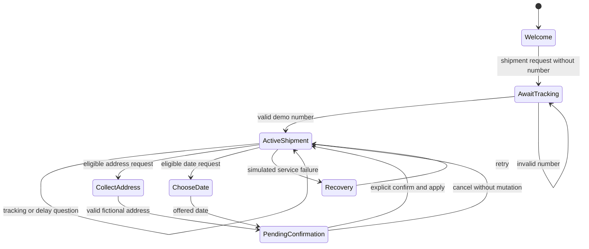

# Conversation design

## Intent inventory

| Intent      | Example                                   | Entities / context                                            |
| ----------- | ----------------------------------------- | ------------------------------------------------------------- |
| track       | Where is my package? / locate / status    | Normalized DEMO number, active shipment                       |
| delay       | Why is it late? / delayed / stuck         | Active shipment and its recorded delay reason                 |
| address     | Change address / redirect / reroute       | Active shipment, proposed fictional address                   |
| reschedule  | Reschedule / another day / delivery date  | Active shipment, one of three offered dates                   |
| human       | Person / agent / representative / someone | Active shipment, request, pending proposal, user-turn summary |
| ambiguous   | Can you change it?                        | Choice among supported intents                                |
| unsupported | Tell me a joke                            | Bounded capability explanation and recovery choices           |

Routing precedence favors explicit support requests, then address/date actions, delays, tracking, ambiguity, and fallback. This is a demonstrable deterministic router, not a claim of natural-language understanding. Buttons submit ordinary text to `respond`, just like the composer.

## State transitions

Ambiguity and unsupported requests are recoverable responses. Human escalation is available from any stage and does not apply pending changes. A new layout is not a conversation transition. Reset alone returns all state to the welcome baseline.

## Example dialogues

**A — Tracking**

User: Where is my package?

Assistant: What’s your demo tracking number? You can choose a fictional shipment below.

User: DEMO123456

Assistant: Here’s the latest on your demo shipment. [In transit card and contextual actions]

**B — Context**

User: Track DEMO234567

Assistant: [Delayed card]

User: Why is it late?

Assistant: Severe weather has paused departures from the Westhaven hub. A new delivery estimate is not available yet.

**C — Address**

User: Change delivery address

Assistant: This shipment is eligible. What fictional address should we deliver to? Include the street and city.

User: 25 Example Street, Northbridge, NY 10001

Assistant: Review this simulated address change. Nothing changes until you confirm. [Confirmation card]

User: Confirm change

Assistant: Your simulated delivery address has been updated. [Updated shipment snapshot]

**D — Date**

User: Reschedule delivery

Assistant: This shipment is eligible. Which demo delivery date would you prefer?

User: November 14, 2026

Assistant: Review your new delivery date. Nothing changes until you confirm.

User: Cancel

Assistant: Cancelled. No delivery changes were made.

**E — Clarification**

User: Can you change it?

Assistant: What would you like help with? [Tracking / address / reschedule / support]

**F — Escalation**

User: I need a person.

Assistant: Here’s a summary you can use when contacting support. This prototype cannot connect you to a real person. [Copyable summary]

**G — Recovery**

Enable the one-shot simulated error before a shipment lookup.

Assistant: Shipment data is temporarily unavailable in this simulated service error. Your conversation is safe. Try again or prepare a support summary.

User: Retry

Assistant: [Recovered shipment response]

## Clarification and fallback rules

Ask one missing detail at a time. A bare tracking number while awaiting tracking resumes the existing task. An explicit new task can replace an unfinished clarification, but a pending confirmation must first be confirmed or cancelled. Do not infer approval from unrelated text. No estimate is fabricated when absent. Historical shipment cards are snapshots; later changes do not rewrite previous messages. Only the latest response exposes live actions; old confirmation buttons remain disabled as a record.
